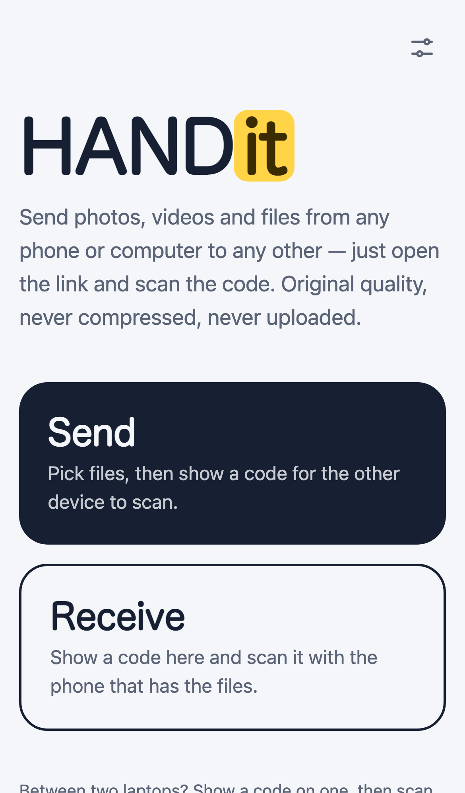
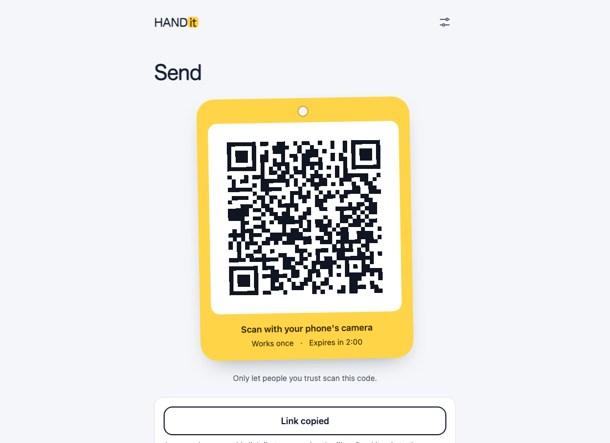
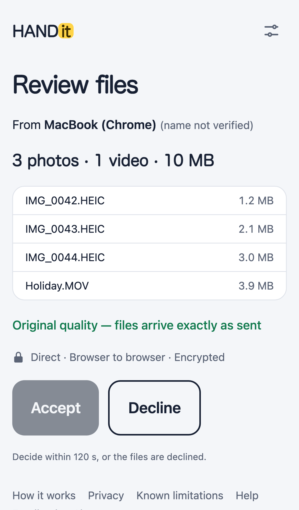
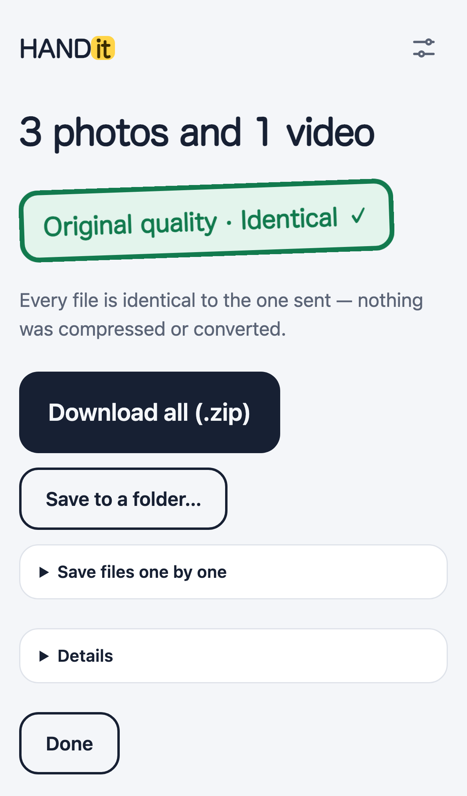
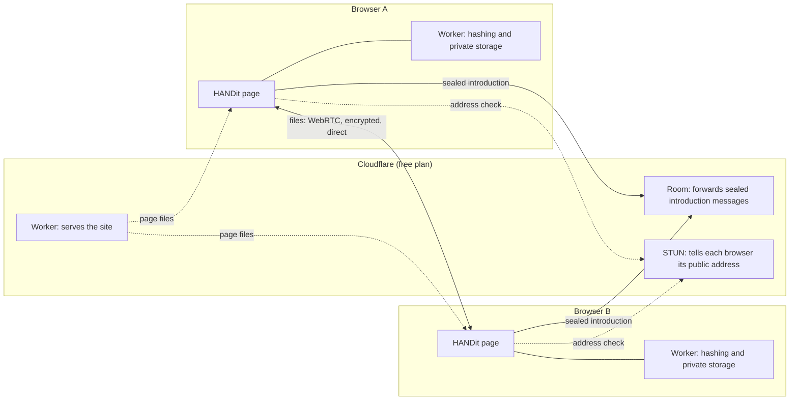

# HANDit

**Send photos, videos and files from any phone or computer to any other — just open the link and scan the code. Original quality, never compressed, never uploaded.**

**Live: [handit.handit-worker.workers.dev](https://handit.handit-worker.workers.dev)** — nothing to install, no account.

> **Public test — not independently security-audited.** This is the one official address; check it before you scan or trust a code.

|                                                                                                    |                                                                                                                |                                                                                                            |                                                                                            |
| -------------------------------------------------------------------------------------------------- | -------------------------------------------------------------------------------------------------------------- | ---------------------------------------------------------------------------------------------------------- | ------------------------------------------------------------------------------------------ |
|  |  |  |  |

## What it does

- **Works between any two devices.** iPhone, Android, Windows, Mac, Linux and Chromebook, in any recent browser. An iPhone can send photos to an Android phone with no app on either.
- **Scan and send.** One device shows a one-time QR code; the other scans it with its normal camera app (or, between two laptops, with its webcam inside the page, or with Copy link).
- **Direct and encrypted.** Files go straight from browser to browser over an encrypted WebRTC connection. They never pass through a server. If a network blocks direct connections, HANDit says so instead of quietly relaying your files.
- **Original quality, proven.** Nothing is compressed, resized or converted. Every file is fingerprinted with SHA-256 on both sides, and "Original quality · Identical ✓" appears only when every file matches.
- **You decide.** The recipient always sees the file list and taps Accept. The sender sees who joined and taps Allow before anything is offered. Apps and scripts are flagged, and received files are never opened for you.
- **Installable.** Add it to a phone's home screen or a desktop; it opens even offline (and tells you it can't reach the server).

## How it works



1. **A device shows a code.** The page makes a 32-byte random secret and puts it in a link. The secret sits after the `#`, the one part of a link browsers never send to a server.
2. **The other device scans it.** The page reads the secret, removes it from the address bar, and works out a room ID and a sealing key from it.
3. **A tiny server introduces the two.** Both devices meet in a short-lived "Room". Everything they say there (device names, connection details) is sealed with the key, so the Room can't read it or change it without being caught.
4. **The files go directly.** The devices open an encrypted WebRTC connection straight to each other and leave the Room, which deletes everything. The recipient reviews the list and accepts; each file is hashed in 1 MiB blocks in a Web Worker and written to the browser's private storage, checked, and only then saved.

## The security design, in plain words

- **The server can't see or change anything that matters.** It sees a room ID that reveals nothing about the secret, plus sealed messages it can't open. A changed message fails its check and the session ends. Each message is numbered, so a replayed one is rejected.
- **The connection can't be hijacked.** Each browser's connection fingerprint travels only inside the sealed messages, so neither the server nor someone on the network can slip in their own.
- **Codes are single-use and short-lived.** One device joins, once, within two minutes (or 1 or 5, in Settings). Someone else who opens a code first is shown to the sender, who can refuse them.
- **Hostile names are made safe.** Names from the other device can't escape a folder, hide an extension, or use a reserved Windows name; collisions get a number.
- **The page can't load other code.** A strict Content Security Policy allows only the site's own origin: no third-party scripts, fonts, analytics or trackers, and no inline code.
- **Limits.** Per-IP limits, size and count limits and a ten-minute room life keep the free service from being used up.

The checklist, the evidence for each item and the threats that remain are in [docs/security-review.md](docs/security-review.md). Honest limits: it hasn't been independently audited; people trust the site's code each time they open it (inherent to any web app); and both devices learn each other's IP address, which a direct connection needs.

## Speed

Measured on one laptop, between two browser profiles on that machine, through the real Room, with every file verified. These numbers show the engine's own limit (hashing, storage and encryption), not a Wi-Fi network; real speeds depend on your network.

| Transfer                   | Result                                                                                                                             |
| -------------------------- | ---------------------------------------------------------------------------------------------------------------------------------- |
| One 1 GiB file             | about 40 MiB/s                                                                                                                     |
| 1,000 photos, 5 GiB in all | all 1,000 verified identical in 113 s, about 44 MiB/s; the page never froze (longest gap between frames 33 ms)                     |
| 10,000 small files         | all verified in 12.9 s; the page never froze (longest gap between frames 17 ms receiving, 450 ms while the sender builds its list) |

## Run it locally

Needs Node.js 26.

```bash
npm install
npm run dev                                      # the site at http://localhost:5173
npm run preview                                  # the site with the Worker and Room at http://localhost:8787
npm run check                                    # lint, type-check, build, unit and Worker tests
npx playwright install chromium firefox webkit   # once, for the browser tests
npm run test:e2e                                 # browser tests: two real browsers send files to each other
```

`npm run deploy` builds the site and deploys the Worker with Wrangler. Pushing to `main` deploys through GitHub Actions once the repository has `CLOUDFLARE_API_TOKEN` and `CLOUDFLARE_ACCOUNT_ID` secrets.

How the tests are organised, and how every message the app can show is triggered, is in [docs/testing.md](docs/testing.md). Why things are the way they are (library choices, spike results, changes to the design) is in [docs/decisions.md](docs/decisions.md).

## Project layout

| Folder    | What's inside                                                                                                                                                                                                                                          |
| --------- | ------------------------------------------------------------------------------------------------------------------------------------------------------------------------------------------------------------------------------------------------------ |
| `web/`    | The site: Vite, React, TypeScript, Tailwind. `src/core/` holds the protocol, crypto and file logic (links, sealing, the direct connection, the transfer engine, filename rules, ZIP); `src/ui/` the screens; `src/strings.ts` every word the app shows |
| `worker/` | The Cloudflare Worker that serves the site, the `Room` that introduces two browsers, and the per-IP `Limiter`                                                                                                                                          |
| `e2e/`    | Playwright tests: journeys, security, the scanner, the installable app, and the QR decoder in three browser engines                                                                                                                                    |
| `docs/`   | Decisions, test results, the security review, screenshots                                                                                                                                                                                              |
| `tools/`  | Scripts that draw the app icons and take the screenshots                                                                                                                                                                                               |

## Known limitations

Both devices need internet access to start (the files themselves go directly). Keep both tabs open and the screen on until it finishes. Very large transfers are limited by the receiving browser's storage; HANDit checks before you accept. Some networks (strict office or campus firewalls, some mobile carriers, VPNs) block direct connections: use the same Wi-Fi or a phone's hotspot. On iPhone, pick photos the way the tip on the Send screen says to keep originals. Received files go to Downloads (or Files), not straight into the gallery: on a phone use Save / Share → Save to Photos.

## Security

To report a vulnerability, see [SECURITY.md](SECURITY.md).

## Credits

Built by Raghav Anand.

## License

[Apache-2.0](LICENSE)
